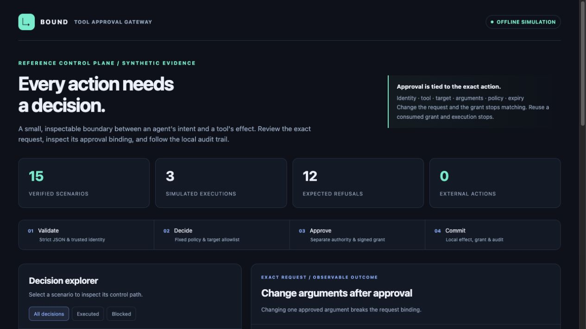
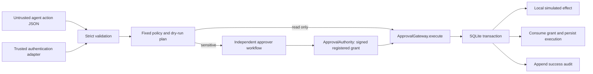

# Tool Approval Gateway

[](https://github.com/demier-demier/tool-approval-gateway/actions/workflows/ci.yml)

**An inspectable control plane between an agent's intent and a tool's effect.**

A Python 3.11+ reference implementation of strict action validation, fixed tool policy, independent approval, exact-request signatures, persistent replay prevention, and scoped audit records. Every connector is a local SQLite simulation. No network calls, shell dispatch, or real notifications occur.

The repository includes an interactive decision explorer with 15 executable synthetic scenarios. Its requests, policy decisions, outcomes, and audit records come from running the gateway, rather than hand-authored screenshots.

**[Integration guide](docs/integration.md) · [Action JSON Schema](docs/action.schema.json) · [Synthetic evidence](docs/demo.json) · [Offline interactive report](docs/demo.html) · [Provenance](PROVENANCE.md)**



## Run it

The runtime and tests use the Python standard library. A clean checkout needs Python 3.11 or newer and no package installation:

```sh
PYTHONPATH=src python3 -m unittest discover -s tests -v
PYTHONPATH=src python3 -m approval_gateway demo --output-dir artifacts/demo
```

Open `artifacts/demo/report.html` in a browser. The generated `report.json` contains the underlying evidence; `gateway.sqlite3` contains the local simulator and audit state. The HTML is self-contained, has no remote assets, and does not access the network. To inspect the committed example directly, download `docs/demo.html` and open it locally.

The demo verifies **15 expected outcomes: 3 simulated executions and 12 refusals**, then writes the report. It generates a fresh runtime HMAC key and never exports that key or usable approval tokens. Its fixed synthetic clock makes the expiry boundary reproducible. Re-running into an existing demo database is refused; choose another output directory to preserve earlier evidence.

Optional package installation provides an `approval-gateway` entry point:

```sh
python3 -m pip install -e .
approval-gateway demo --output-dir artifacts/installed-demo
```

The optional build frontend may need to obtain `setuptools`; the source-based quickstart above remains entirely offline.

## What the boundary enforces

| Layer | Behavior |
| --- | --- |
| Input | Exact property sets; duplicate-key, unknown-field, oversized, deeply nested, non-finite, and wrong-type rejection |
| Identity | Request tenant and principal must match a trusted `AccessContext` supplied outside the request body |
| Policy | Three fixed tool names and fixture target allowlists; unknown tools fail closed |
| Planning | A dry-run decision includes the exact arguments and canonical request digest, with no simulator or audit mutation |
| Approval | A different, same-tenant principal with the trusted `approver` role must issue a grant through `ApprovalAuthority` |
| Binding | HMAC-SHA256 covers grant ID, identity, tool, target, canonical request digest, policy version, approver, issue time, and expiry |
| Replay | A persisted grant registry and tenant/request uniqueness survive a gateway restart |
| Commit | Local effect, grant consumption, execution record, and success audit share one SQLite transaction |
| Evidence | Tenant-scoped audit access; refusal logs exclude raw requests and approval tokens |

There are two executable risk classes: `read_only` and `sensitive`. Requests outside the policy are denied before dispatch; there is no fallback connector. Sensitive actions remain sensitive even if the model describes them as safe.

| Tool | Risk | Allowed local effect |
| --- | --- | --- |
| `catalog.lookup` | Read only | Read one of three synthetic item quantities |
| `inventory.adjust` | Sensitive | Adjust a synthetic quantity by a bounded nonzero integer |
| `notifications.send` | Sensitive | Store text in the local simulator database; no delivery |

## Architecture and trust model



The agent controls action JSON and may submit a grant. The trusted application controls authenticated identity, role assignment, the allowlist, signing key, database, and approver workflow. `AccessContext` is an **assertion from your authentication layer**, not an authentication mechanism. Constructing it from model-provided fields defeats the boundary. `ApprovalAuthority.issue` must be reachable only through a separately authenticated approval route, never as an agent-callable tool.

HMAC issuer and verifier both possess the signing secret and are both trusted. This is an in-process reference, not process isolation. Code running with the same privileges can bypass the library, mint contexts, modify the database, or access the key. A signer-compromised or storage-compromised host is outside its threat model.

Request canonicalization uses sorted keys, compact separators, escaped Unicode, and bounded validated types. It is a project-local format, **not a claim of RFC 8785 compliance**. JSON property order and whitespace are immaterial; strings remain exact, including Unicode composition. The request ID is also signed through the digest. Changing any approved argument, identity, tool, target, or request ID requires a new grant.

Approval validity is `issued_at <= now < expires_at`, checked after SQLite acquires its write lock. TTL is 1–300 seconds. Policy version changes invalidate old grants. SQLite `BEGIN IMMEDIATE` serializes competing writers; an eight-caller concurrency test confirms one committed local effect from duplicate submissions. Read-only calls also receive a persisted execution record, and duplicate tenant/request IDs are rejected.

## What the tests establish

The standard-library suite exercises argument and target tampering, token alteration, unauthorized and self approval, wrong identity and tenant, canonical JSON equivalence, request replay after reinstantiation, expiry boundaries, concurrent duplicates, malformed payloads, audit scoping, rollback after partial simulator writes, and rollback when the audit write fails. Report tests verify inert embedded markup, exact content-security-policy hashes, and the complete demo's persisted evidence.

GitHub Actions runs the tests and demo on Python 3.11, 3.12, and 3.13 and uploads the HTML and JSON reports. A passing local run establishes local behavior only; inspect the repository's actual Actions run for CI status.

## Deliberate limits

- This is a reference control plane, not a comprehensive prompt-injection defense, authentication system, or production authorization service. It validates and gates effects; it does not determine whether an approver was deceived.
- All mutation happens in one local SQLite transaction. **This does not promise exactly-once effects in an external API.** External connectors need a durable dispatch design, idempotency keys, outcome reconciliation, and explicit retry semantics. See the integration guide.
- The database and clock are trusted. Audit rows are application-append-only, not cryptographically immutable. Restoring an older database snapshot can restore an unconsumed grant; HMAC does not protect database history. Use a protected durable store and revoke outstanding grants after rollback or restore.
- Roles are coarse and static. There is no role revocation check, per-resource access service, key rotation protocol, approval revocation API, rate limiting, retention policy, or distributed deployment support.
- Grants expire quickly, but authorization and resource state may change after review. A production adapter must recheck current permissions and relevant state at dispatch. A dry-run plan is neither a reservation nor a guarantee of future success.
- SQLite retains synthetic notification bodies and result data. The report contains its synthetic inputs. Real integrations need explicit data minimization, encryption, access, and retention controls; do not feed private data into this demo.

## Repository map

```text
src/approval_gateway/
  models.py       strict JSON parsing, action types, trusted context
  approvals.py    separate approval authority and HMAC envelope
  gateway.py      policy, execution checks, fixed local simulators
  storage.py      transaction boundary and scoped audit records
  demo.py         executable synthetic scenarios
  report.py       offline interactive HTML, safe text rendering
  cli.py          demo command
tests/            adversarial behavior and report verification
docs/             schema, integration guide, generated evidence
examples/         small runnable integration example
```

All implementation and fixture material was created for this repository. [PROVENANCE.md](PROVENANCE.md) describes AI assistance, synthetic data, and the scope of the evidence.
